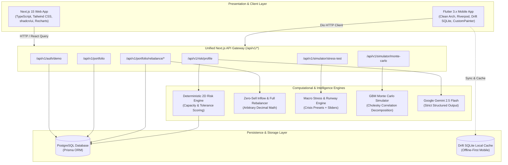
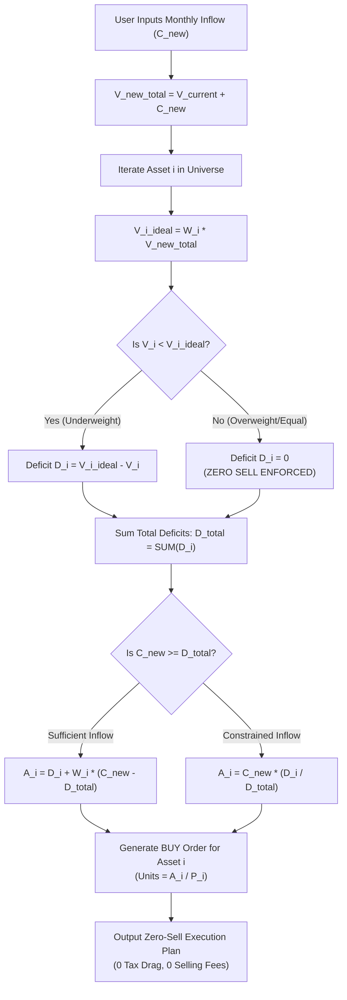
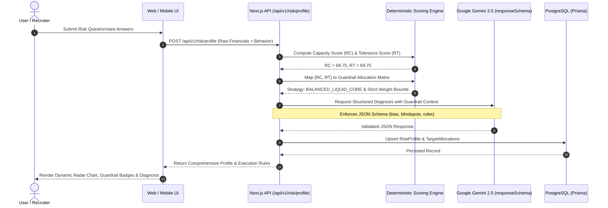

# QuantVanguard: Institutional-Grade Multi-Asset Portfolio Rebalancer, AI Risk Profiler & Macro Stress-Test Simulator
## Comprehensive System Specification & Shared Architecture Document

---

### Table of Contents
1. [Monorepo Workspace & Architectural Vision](#1-monorepo-workspace--architectural-vision)
2. [Core Domain & Asset Class Definitions](#2-core-domain--asset-class-definitions)
3. [Mathematical Engine & Computational Models](#3-mathematical-engine--computational-models)
   - 3.1 [Deterministic 2D Risk Scoring & Guardrail Allocation Matrix](#31-deterministic-2d-risk-scoring--guardrail-allocation-matrix)
   - 3.2 [Gemini Structured Output & Psychological Diagnosis Schema](#32-gemini-structured-output--psychological-diagnosis-schema)
   - 3.3 [Rebalancing Mathematics: Full Mode vs. Zero-Sell Inflow Optimization](#33-rebalancing-mathematics-full-mode-vs-zero-sell-inflow-optimization)
   - 3.4 [Macro Stress-Test & Liquid Survival Runway Formulation](#34-macro-stress-test--liquid-survival-runway-formulation)
   - 3.5 [10-Year Monte Carlo & Lump-Sum vs. DCA Simulation Model](#35-10-year-monte-carlo--lump-sum-vs-dca-simulation-model)
4. [Complete Database Schema (Prisma ORM for PostgreSQL)](#4-complete-database-schema-prisma-orm-for-postgresql)
5. [Shared REST API Contract (`/api/v1/*`)](#5-shared-rest-api-contract-apiv1)
6. [Recruiter Guest Demo Portfolio Specification](#6-recruiter-guest-demo-portfolio-specification)
7. [System Architecture & Visual Workflows](#7-system-architecture--visual-workflows)

---

## 1. Monorepo Workspace & Architectural Vision

**QuantVanguard** is an institutional-grade, cross-platform personal finance and portfolio rebalancing platform engineered for multi-asset wealth builders. It empowers investors to eliminate emotional bias through deterministic algorithmic rebalancing, quantify drawdown resilience against macro financial crises, and receive generative AI risk profiling constrained by rigorous mathematical guardrails.

### 1.1 Architectural Topology
The project is architected as a high-performance monorepo:
- **`/docs/SPEC.md`**: The immutable, definitive single source of truth containing domain logic, mathematical formulations, Prisma database schemas, and shared REST API specifications.
- **`/apps/web`**: **Next.js 15+ (App Router)** with TypeScript, Tailwind CSS, shadcn/ui component primitives, Recharts visualization library, Prisma ORM, Decimal.js arbitrary-precision financial mathematics, and Google Gemini API integration (`@google/genai`). Serves both the interactive desktop/tablet responsive Web UI and the shared `/api/v1/*` REST API consumed by both web and mobile clients.
- **`/apps/mobile`**: **Flutter 3.x+** application built using **Clean Architecture** (Presentation, Domain, Data layers), **Riverpod 2.x** for state management, **Dio** with offline interception, **Drift (SQLite)** for offline-first local cache synchronization, **Decimal** for zero floating-point drift calculations, **CustomPainter** for canvas-based financial charts, and **Dart Isolates** for background Monte Carlo simulations.

### 1.2 Core Principles
1. **Zero Precision Loss**: All currency amounts, units, shares, and target ratios are represented using arbitrary-precision decimals (`Decimal.js` in TypeScript, `Decimal` in Dart) rather than native binary 64-bit floating point (`number` / `double`), preventing IEEE 754 rounding inaccuracies.
2. **Dual-Currency & Inflation Neutrality**: Every valuation supports real-time switching between Indonesian Rupiah (`IDR`) and US Dollars (`USD`), paired with an inflation-adjustment toggle ("Nominal Return" vs. "Real Return" after deducting national CPI trends).
3. **Deterministic Superiority**: AI never invents portfolio weights freely. The deterministic 2D Risk Capacity & Tolerance matrix establishes strict mathematical guardrails, and Google Gemini operates strictly within these bounds via validated JSON structured output.

---

## 2. Core Domain & Asset Class Definitions

QuantVanguard organizes capital across 4 distinct asset classes, representing a robust all-weather barbell distribution:

| Asset Code | Name & Description | Benchmark / Instrument | Historical Nominal CAGR | Annual Volatility ($\sigma$) | Liquidity / Settlement | Precision |
| :--- | :--- | :--- | :--- | :--- | :--- | :--- |
| **`MMF_IDR`** | Money Market Mutual Fund (Reksadana Pasar Uang / RDPU) | Indonesian IDR Institutional MMF | ~4.50% - 5.50% p.a. | ~1.2% (Minimal) | Immediate (T+0 / T+1) | 4 decimal places |
| **`ETF_VOO`** | US Large-Cap Equity Index ETF | Vanguard S&P 500 ETF (VOO) | ~10.50% p.a. | ~16.5% (Moderate) | T+1 US Market Hours | 4 decimal places |
| **`GOLD_XAU`** | Physical / Digital Investment Gold | London Bullion Market Association (LBMA) Spot XAU | ~8.00% p.a. | ~14.0% (Medium) | Instant / T+1 (Physical/Digital) | 4 decimal places |
| **`CRYPTO_BTC`**| Bitcoin Digital Reserve Asset | Spot BTC / IDR & USD Pairs | ~28.00% p.a. (Historical) | ~58.0% (High-Beta) | 24/7/365 On-chain / Exchange | **8 decimal places** (1 Satoshi = 0.00000001 BTC) |

### 2.1 Multi-Currency Handling
- **Base Functional Currency**: IDR (Indonesian Rupiah).
- **Secondary Display Currency**: USD (United States Dollar).
- **Exchange Rate Engine**: Exchange rate $FX_{\text{USD/IDR}}$ is persisted per snapshot and real-time queryable (default anchor: $1 \text{ USD} = 15,850 \text{ IDR}$).
- **Conversion Formulation**:
  $$V_{\text{USD}} = \frac{V_{\text{IDR}}}{FX_{\text{USD/IDR}}}, \quad V_{\text{IDR}} = V_{\text{USD}} \times FX_{\text{USD/IDR}}$$

---

## 3. Mathematical Engine & Computational Models

### 3.1 Deterministic 2D Risk Scoring & Guardrail Allocation Matrix

The investor profile is evaluated across two orthogonal financial dimensions: **Risk Capacity** (objective financial ability to absorb sustained losses) and **Risk Tolerance** (subjective psychological willingness to endure volatility).

#### A. Risk Capacity Score ($RC \in [0, 100]$)
Risk Capacity evaluates hard balance sheet indicators:
1. **Emergency Fund Runway ($M \ge 0$ months):**
   $$f_{\text{runway}}(M) = \min\left(100, M \times \frac{100}{12}\right)$$
   *(Full score at $\ge 12$ months of liquid living expenses).*
2. **Monthly Savings Ratio ($S \in [0, 1]$ where $S = \frac{\text{Monthly Savings}}{\text{Monthly Net Income}}$):**
   $$f_{\text{savings}}(S) = \min\left(100, \frac{S}{0.50} \times 100\right)$$
   *(Full score at $\ge 50\%$ savings rate).*
3. **Investment Time Horizon ($H \ge 1$ years):**
   $$f_{\text{horizon}}(H) = \min\left(100, \frac{H}{15} \times 100\right)$$
   *(Full score at $\ge 15$ years).*
4. **Income Stability Score ($C \in \{20, 50, 80, 100\}$):**
   - High Volatility (Freelance / Commission-only / Early Startup): $C = 20$
   - Moderate Volatility (Contract Employee / Variable Bonus): $C = 50$
   - High Stability (Corporate Professional / Established SME): $C = 80$
   - Guaranteed / Public Tenured (Civil Servant / Medical / Academic): $C = 100$

**Total Risk Capacity Formula:**
$$RC = 0.30 \times f_{\text{runway}}(M) + 0.25 \times f_{\text{savings}}(S) + 0.25 \times f_{\text{horizon}}(H) + 0.20 \times C$$

#### B. Risk Tolerance Score ($RT \in [0, 100]$)
Risk Tolerance quantifies emotional reaction and past behavioral patterns:
1. **Reaction to Sudden -25% Market Drawdown ($R \in \{0, 25, 50, 75, 100\}$):**
   - "Panic-sell everything into cash immediately to prevent further loss": $R = 0$
   - "Liquidate half of risky holdings and move to safety": $R = 25$
   - "Feel distressed and check prices daily, but maintain position": $R = 50$
   - "Stay calm and opportunistically allocate spare cash": $R = 75$
   - "Celebrate discounted prices and aggressively deploy reserves": $R = 100$
2. **Comfort with Portfolio Volatility ($K \in \{10, 40, 70, 100\}$):**
   - Prioritizes capital preservation above all else: $K = 10$
   - Can tolerate mild short-term fluctuations ($\pm 5\%$): $K = 40$
   - Comfortable with cyclical bull/bear swings ($\pm 20\%$): $K = 70$
   - Pursues maximum asymmetric upside despite stomach-churning drawdowns: $K = 100$
3. **Market Experience Through Major Market Cycles ($E \ge 0$ years):**
   $$f_{\text{experience}}(E) = \min\left(100, \frac{E}{10} \times 100\right)$$

**Total Risk Tolerance Formula:**
$$RT = 0.45 \times R + 0.30 \times K + 0.25 \times f_{\text{experience}}(E)$$

#### C. Guardrail Allocation Matrix
The 2D coordinate $(RC, RT)$ deterministically maps into one of 5 canonical strategies. Each strategy enforces strict minimum and maximum percentage boundaries that generative AI cannot violate:

```
               Risk Tolerance (RT)
            0        35       50       70       85      100
         100+--------+--------+--------+--------+--------+
            |        |        |        | Growth | Asymm. |
            |        | Preser-| Balanced| Accumu-| Alpha  |
          75| Defen- | ver    | Core   | lator  | (Tier 5)|
Risk        | sive   | (Tier2)| (Tier3)| (Tier 4)|        |
Capacity  50| (Tier1)|--------+--------+--------+--------+
(RC)        |        | Defensive       | Balanced        |
          25|        | Liquidity-First | Core (Capped)   |
            |        | (Capacity Cap)  |                 |
           0+--------+-----------------+-----------------+
```

##### Canonical Target Weights & Guardrails:
1. **Tier 1: Defensive Liquidity-First** ($RC < 40 \lor RT < 35$)
   - *Target Weights:* `MMF_IDR`: 70%, `GOLD_XAU`: 15%, `ETF_VOO`: 15%, `CRYPTO_BTC`: 0%
   - *Guardrails:* MMF [60% - 90%], Gold [10% - 25%], VOO [5% - 20%], BTC [0% - 0%]
2. **Tier 2: Conservative Capital Preserver** ($40 \le RC < 55 \lor 35 \le RT < 50$)
   - *Target Weights:* `MMF_IDR`: 50%, `GOLD_XAU`: 25%, `ETF_VOO`: 20%, `CRYPTO_BTC`: 5%
   - *Guardrails:* MMF [40% - 65%], Gold [15% - 30%], VOO [15% - 30%], BTC [0% - 8%]
3. **Tier 3: Balanced Liquid-Core** ($55 \le RC < 75 \land 50 \le RT < 70$)
   - *Target Weights:* `MMF_IDR`: 40%, `GOLD_XAU`: 20%, `ETF_VOO`: 20%, `CRYPTO_BTC`: 20%
   - *Guardrails:* MMF [30% - 50%], Gold [15% - 25%], VOO [15% - 30%], BTC [10% - 25%]
4. **Tier 4: Growth Accumulator** ($70 \le RC < 85 \land 70 \le RT < 85$)
   - *Target Weights:* `MMF_IDR`: 20%, `GOLD_XAU`: 15%, `ETF_VOO`: 45%, `CRYPTO_BTC`: 20%
   - *Guardrails:* MMF [10% - 30%], Gold [10% - 20%], VOO [35% - 55%], BTC [15% - 25%]
5. **Tier 5: Aggressive Asymmetric Alpha** ($RC \ge 85 \land RT \ge 85$)
   - *Target Weights:* `MMF_IDR`: 10%, `GOLD_XAU`: 10%, `ETF_VOO`: 50%, `CRYPTO_BTC`: 30%
   - *Guardrails:* MMF [5% - 15%], Gold [5% - 15%], VOO [40% - 60%], BTC [20% - 35%]

---

### 3.2 Gemini Structured Output & Psychological Diagnosis Schema

The Next.js backend leverages `@google/genai` with `gemini-2.5-flash` using strict `responseSchema` to guarantee schema compliance.

```typescript
export const RiskProfileResponseSchema = {
  type: "OBJECT",
  properties: {
    strategy_name: {
      type: "STRING",
      description: "One of the 5 canonical strategy names",
    },
    target_allocations: {
      type: "OBJECT",
      properties: {
        MMF_IDR: { type: "NUMBER", description: "Target allocation % for MMF_IDR" },
        ETF_VOO: { type: "NUMBER", description: "Target allocation % for ETF_VOO" },
        GOLD_XAU: { type: "NUMBER", description: "Target allocation % for GOLD_XAU" },
        CRYPTO_BTC: { type: "NUMBER", description: "Target allocation % for CRYPTO_BTC" },
      },
      required: ["MMF_IDR", "ETF_VOO", "GOLD_XAU", "CRYPTO_BTC"],
    },
    psychological_diagnosis: {
      type: "OBJECT",
      properties: {
        dominant_bias: { type: "STRING", description: "Identified behavioral bias (e.g., Loss Aversion, FOMO, Recency Bias)" },
        stress_resilience: { type: "STRING", description: "Qualitative assessment of user emotional stamina in downturns" },
        capacity_vs_tolerance_delta: { type: "STRING", description: "Analysis of discrepancy between capacity and tolerance" }
      },
      required: ["dominant_bias", "stress_resilience", "capacity_vs_tolerance_delta"]
    },
    blindspots: {
      type: "ARRAY",
      items: { type: "STRING" },
      description: "Specific balance sheet and psychological blindspots to watch"
    },
    execution_rules: {
      type: "ARRAY",
      items: { type: "STRING" },
      description: "Concrete rules for portfolio discipline, rebalancing intervals, and liquidity reserves"
    }
  },
  required: ["strategy_name", "target_allocations", "psychological_diagnosis", "blindspots", "execution_rules"]
};
```

---

### 3.3 Rebalancing Mathematics: Full Mode vs. Zero-Sell Inflow Optimization

Let $N = 4$ represent the asset universe $\{ \text{MMF\_IDR}, \text{ETF\_VOO}, \text{GOLD\_XAU}, \text{CRYPTO\_BTC} \}$.
- Current units held: $q_i \ge 0$
- Current unit price (in IDR): $P_i > 0$
- Current market valuation: $V_i = q_i \times P_i$
- Total current portfolio valuation:
  $$V_{\text{total}} = \sum_{i=1}^N V_i$$
- Current weight of asset $i$:
  $$w_i = \frac{V_i}{V_{\text{total}}}$$
- Target weight: $W_i \in (0, 1)$ where $\sum_{i=1}^N W_i = 1.0$.
- Drift for asset $i$:
  $$\Delta w_i = w_i - W_i$$
- **Drift Alert Trigger**: An active drift alert is flagged whenever $\exists i \text{ such that } |\Delta w_i| \ge \theta_{\text{drift}}$ (default $\theta_{\text{drift}} = 0.05$ or $5\%$).

#### Mode A: Full Rebalance (Taxable / Realization Mode)
Full rebalance restores every asset weight precisely to $W_i$ via simultaneous liquidation of overweight assets and purchasing of underweight assets.
1. Target value for asset $i$:
   $$V_i^* = W_i \times V_{\text{total}}$$
2. Required nominal adjustment:
   $$\Delta V_i = V_i^* - V_i$$
3. Trade Execution Logic:
   - If $\Delta V_i > 0$: **BUY** action of nominal amount $\Delta V_i$. Additional units to purchase:
     $$\Delta q_i = \frac{\Delta V_i}{P_i}$$
   - If $\Delta V_i < 0$: **SELL** action of nominal amount $|\Delta V_i|$. Units to liquidate:
     $$\Delta q_i = \frac{|\Delta V_i|}{P_i}$$
4. **Self-Financing Invariance**:
   $$\sum_{i=1}^N \Delta V_i = \sum_{i=1}^N (W_i V_{\text{total}} - V_i) = V_{\text{total}} \sum_{i=1}^N W_i - \sum_{i=1}^N V_i = V_{\text{total}} - V_{\text{total}} = 0$$

#### Mode B: "Zero-Sell" Smart Cash-Flow Inflow Rebalance (No Tax / Fee Drag)
When an investor contributes monthly savings or new capital $C_{\text{new}} > 0$, QuantVanguard computes an optimal capital allocation vector $\vec{A} = (A_1, A_2, \dots, A_N)$ that routes $C_{\text{new}}$ exclusively into underweight positions, ensuring **no existing assets are sold** ($\forall i, \text{SELL}_i = 0$), eliminating capital gains tax, transaction fees, and bid-ask spreads.

1. Projected post-inflow total valuation:
   $$V_{\text{new\_total}} = V_{\text{total}} + C_{\text{new}}$$
2. Ideal post-inflow value for each asset:
   $$V_i^{\text{ideal}} = W_i \times V_{\text{new\_total}}$$
3. Deficit for each asset (gap required to hit target):
   $$D_i = \max\left(0, V_i^{\text{ideal}} - V_i\right)$$
4. Total deficit across all assets:
   $$D_{\text{total}} = \sum_{i=1}^N D_i$$
5. Allocation Routing:
   - **Case 1: Sufficient Inflow ($C_{\text{new}} \ge D_{\text{total}}$):**
     New capital is large enough to bridge all deficits completely.
     $$A_i = D_i + W_i \times (C_{\text{new}} - D_{\text{total}})$$
     Post-allocation weight for every asset $i$ reaches exact target $W_i$.
   - **Case 2: Constrained Inflow ($0 < C_{\text{new}} < D_{\text{total}}$):**
     New capital is insufficient to bridge all deficits. Inflow is distributed proportionally to individual deficits:
     $$A_i = C_{\text{new}} \times \frac{D_i}{D_{\text{total}}}$$
     For any overweight asset ($V_i \ge V_i^{\text{ideal}}$), $D_i = 0 \implies A_i = 0$.
     Units to buy:
     $$\Delta q_i = \frac{A_i}{P_i}$$
6. **Convergence Proof**:
   Since $\forall i \text{ with } w_i > W_i, A_i = 0$, the post-inflow weight of overweight assets is:
   $$w_i^{\text{post}} = \frac{V_i}{V_{\text{total}} + C_{\text{new}}} < \frac{V_i}{V_{\text{total}}} = w_i$$
   The aggregate drift metric strictly decreases:
   $$\sum_{i=1}^N \left| w_i^{\text{post}} - W_i \right| < \sum_{i=1}^N \left| w_i - W_i \right|$$

---

### 3.4 Macro Stress-Test & Liquid Survival Runway Formulation

The simulator models catastrophic tail-risk scenarios to verify whether an investor's balance sheet can survive without forced liquidation of depressed assets.

#### A. Historical Crisis Presets
The system provides 3 calibrated historical shock vectors $\vec{s} = (s_{\text{MMF}}, s_{\text{ETF}}, s_{\text{Gold}}, s_{\text{BTC}})$:
1. **2008 Global Financial Crisis (Subprime Meltdown):**
   - $s_{\text{MMF}} = +4.0\%$ (flight to cash/liquidity yields)
   - $s_{\text{ETF}} = -38.0\%$ (S&P 500 collapse)
   - $s_{\text{Gold}} = +5.5\%$ (initial liquidity drag followed by gold rebound)
   - $s_{\text{BTC}} = -50.0\%$ (synthetic high-beta risk asset proxy)
2. **2020 COVID-19 Flash Crash:**
   - $s_{\text{MMF}} = +4.5\%$
   - $s_{\text{ETF}} = -34.0\%$
   - $s_{\text{Gold}} = +12.0\%$ (safe haven surge)
   - $s_{\text{BTC}} = -50.0\%$ (severe March 2020 liquidation wick)
3. **2022 Fed Rate-Hike Bear Market & Tech Deleveraging:**
   - $s_{\text{MMF}} = +3.5\%$
   - $s_{\text{ETF}} = -19.0\%$
   - $s_{\text{Gold}} = -0.5\%$
   - $s_{\text{BTC}} = -64.0\%$ (crypto winter)

#### B. Valuation Shock Equation
For any shock vector $\vec{s}$ (preset or custom slider $-80\% \text{ to } +100\%$ per asset):
- Post-shock asset valuation: $V_i' = V_i \times (1 + s_i)$
- Post-shock total portfolio: $V_{\text{post}} = \sum_{i=1}^N V_i'$
- Total Portfolio Drawdown (%):
  $$\text{Drawdown} = \frac{V_{\text{post}} - V_{\text{total}}}{V_{\text{total}}} \times 100\%$$

#### C. Liquid Survival Runway Metric ($R_{\text{runway}}$)
Quantifies how many months of non-discretionary living expenses ($E_{\text{monthly}}$) the investor can fund purely from safe liquid reserves (`MMF_IDR` + `GOLD_XAU` with an institutional liquidation haircut), completely shielding `ETF_VOO` and `CRYPTO_BTC` from distressed firesales.

1. Safe Liquid Reserve Valuation ($V_{\text{safe}}$):
   $$V_{\text{safe}} = V_{\text{MMF\_IDR}}' + (1 - \lambda_{\text{haircut}}) \times V_{\text{GOLD\_XAU}}'$$
   *(Default physical gold liquidity spread haircut $\lambda_{\text{haircut}} = 0.15$ or $15\%$, reflecting buyback spreads).*
2. Inflation-Adjusted Monthly Living Expense at month $m$:
   $$E(m) = E_{\text{monthly}} \times \left(1 + \frac{\pi_{\text{annual}}}{12}\right)^m$$
   *(where $\pi_{\text{annual}}$ is national annualized inflation rate, default $3.5\%$).*
3. Liquid Survival Runway ($R_{\text{runway}}$ in months):
   $$R_{\text{runway}} = \frac{V_{\text{safe}}}{E_{\text{monthly}}}$$
4. Qualitative Health Threshold:
   - $R_{\text{runway}} < 6 \text{ months}$: **CRITICAL LIQUIDITY RISK** (High vulnerability to forced liquidation at market bottoms).
   - $6 \le R_{\text{runway}} < 18 \text{ months}$: **MODERATE RESILIENCE** (Sufficient for standard recessions).
   - $R_{\text{runway}} \ge 18 \text{ months}$: **FORTRESS BALANCE SHEET** (Can outlast multi-year cyclical bear markets with zero forced selling).

---

### 3.5 10-Year Monte Carlo & Lump-Sum vs. DCA Simulation Model

The engine models portfolio growth over a 120-month horizon ($T = 10 \text{ years}, \Delta t = \frac{1}{12}$) using correlated Geometric Brownian Motion (GBM):

$$S_i(t + \Delta t) = S_i(t) \exp\left( \left(\mu_i - \frac{1}{2}\sigma_i^2\right)\Delta t + \sigma_i \sqrt{\Delta t} Z_i \right)$$

where $\vec{Z} = (Z_1, \dots, Z_N)^T \sim \mathcal{N}(\mathbf{0}, \mathbf{\Sigma}_{\text{corr}})$.
$\mathbf{\Sigma}_{\text{corr}}$ is the correlation matrix decomposed via Cholesky factor $\mathbf{L}$ ($\mathbf{\Sigma}_{\text{corr}} = \mathbf{L}\mathbf{L}^T$) so that $\vec{Z} = \mathbf{L} \vec{\epsilon}$ with $\epsilon_j \sim \text{i.i.d. } \mathcal{N}(0, 1)$.

#### Asset Parameter Calibration Matrix:
$$\begin{pmatrix}
\text{Asset} & \mu_i \text{ (Annual Drift)} & \sigma_i \text{ (Annual Volatility)} \\
\text{MMF\_IDR} & 0.050 & 0.012 \\
\text{ETF\_VOO} & 0.105 & 0.165 \\
\text{GOLD\_XAU} & 0.080 & 0.140 \\
\text{CRYPTO\_BTC} & 0.280 & 0.580
\end{pmatrix}$$

#### Correlation Matrix ($\mathbf{\Sigma}_{\text{corr}}$):
$$\begin{pmatrix}
 & \text{MMF} & \text{ETF} & \text{Gold} & \text{BTC} \\
\text{MMF} & 1.00 & 0.00 & 0.00 & 0.00 \\
\text{ETF} & 0.00 & 1.00 & -0.05 & 0.35 \\
\text{Gold} & 0.00 & -0.05 & 1.00 & 0.12 \\
\text{BTC} & 0.00 & 0.35 & 0.12 & 1.00
\end{pmatrix}$$

#### 3 Distinct Comparison Trajectories:
1. **Trajectory 1: Baseline Median Growth (50th Percentile)**: Represents the standard median path across $N = 1,000$ simulation runs with buy-and-hold rebalancing drift.
2. **Trajectory 2: Disciplined Rebalancing Growth**: Simulates quarterly systematic rebalancing back to target weights, capturing the *volatility harvesting premium* (Shannon's Demon effect: $+0.80\% \text{ to } +1.40\%$ annualized incremental CAGR).
3. **Trajectory 3: Year-3 Crisis Shock Stress Path**: Inserts a synthetic -35% equity and -55% crypto liquidity shock at Month 36 followed by a 24-month mean-reverting recovery curve.

#### Lump-Sum vs. DCA Comparison:
- **Lump-Sum**: Deploys entire principal $C_0$ at Month 0.
- **Monthly DCA**: Deploys $\frac{C_0}{120}$ or recurring monthly savings $C_{\text{monthly}}$ across all 120 months.
- Evaluates Terminal Wealth, Maximum Drawdown during 10-year period, and Sharpe Ratio.

---

## 4. Complete Database Schema (Prisma ORM for PostgreSQL)

```prisma
datasource db {
  provider = "postgresql"
  url      = env("DATABASE_URL")
}

generator client {
  provider = "prisma-client-js"
}

enum AssetCode {
  MMF_IDR
  ETF_VOO
  GOLD_XAU
  CRYPTO_BTC
}

enum StrategyName {
  DEFENSIVE_LIQUIDITY_FIRST
  CONSERVATIVE_CAPITAL_PRESERVER
  BALANCED_LIQUID_CORE
  GROWTH_ACCUMULATOR
  AGGRESSIVE_ASYMMETRIC_ALPHA
}

enum RebalanceMode {
  FULL
  ZERO_SELL_INFLOW
}

model User {
  id              String           @id @default(uuid())
  email           String           @unique
  name            String
  isDemoUser      Boolean          @default(false)
  createdAt       DateTime         @default(now())
  updatedAt       DateTime         @updatedAt

  riskProfile     RiskProfile?
  portfolios      Portfolio[]

  @@map("users")
}

model RiskProfile {
  id                       String       @id @default(uuid())
  userId                   String       @unique
  user                     User         @relation(fields: [userId], references: [id], onDelete: Cascade)
  
  // Deterministic scores
  capacityScore            Decimal      @db.Decimal(5, 2)
  toleranceScore           Decimal      @db.Decimal(5, 2)
  strategyName             StrategyName
  
  // Deterministic inputs
  emergencyFundMonths      Decimal      @db.Decimal(5, 2)
  monthlySavingsRatio      Decimal      @db.Decimal(5, 4)
  investmentHorizonYears   Int
  incomeStabilityScore     Int
  crashReactionScore       Int
  volatilityComfortScore   Int
  experienceYears          Int
  
  // Guardrail target allocations: { "MMF_IDR": 0.40, "ETF_VOO": 0.20, "GOLD_XAU": 0.20, "CRYPTO_BTC": 0.20 }
  targetAllocations        Json
  
  // Gemini AI synthesis
  geminiDiagnosis          Json
  
  createdAt                DateTime     @default(now())
  updatedAt                DateTime     @updatedAt

  @@map("risk_profiles")
}

model Portfolio {
  id                  String               @id @default(uuid())
  userId              String
  user                User                 @relation(fields: [userId], references: [id], onDelete: Cascade)
  
  name                String               @default("Primary Wealth Portfolio")
  baseCurrency        String               @default("IDR") // "IDR" or "USD"
  monthlyExpenses     Decimal              @db.Decimal(18, 2) // Living expenses for liquid runway
  
  holdings            AssetHolding[]
  snapshots           HistoricalSnapshot[]
  rebalanceLogs       RebalanceLog[]
  stressScenarios     MacroStressScenario[]

  createdAt           DateTime             @default(now())
  updatedAt           DateTime             @updatedAt

  @@map("portfolios")
}

model AssetHolding {
  id              String      @id @default(uuid())
  portfolioId     String
  portfolio       Portfolio   @relation(fields: [portfolioId], references: [id], onDelete: Cascade)
  
  assetCode       AssetCode
  units           Decimal     @db.Decimal(24, 8) // Supports 8 decimal places for BTC
  costBasisPrice  Decimal     @db.Decimal(18, 4) // In base currency (IDR)
  currentPrice    Decimal     @db.Decimal(18, 4) // In base currency (IDR)
  currency        String      @default("IDR")
  
  lastPriceUpdate DateTime    @default(now())
  createdAt       DateTime    @default(now())
  updatedAt       DateTime    @updatedAt

  @@unique([portfolioId, assetCode])
  @@map("asset_holdings")
}

model HistoricalSnapshot {
  id              String      @id @default(uuid())
  portfolioId     String
  portfolio       Portfolio   @relation(fields: [portfolioId], references: [id], onDelete: Cascade)
  
  snapshotDate    DateTime
  totalValueIdr   Decimal     @db.Decimal(20, 2)
  totalCostBasis  Decimal     @db.Decimal(20, 2)
  usdIdrRate      Decimal     @db.Decimal(10, 2)
  
  // Detailed holdings at that point in time
  breakdown       Json
  
  createdAt       DateTime    @default(now())

  @@index([portfolioId, snapshotDate])
  @@map("historical_snapshots")
}

model RebalanceLog {
  id              String         @id @default(uuid())
  portfolioId     String
  portfolio       Portfolio      @relation(fields: [portfolioId], references: [id], onDelete: Cascade)
  
  mode            RebalanceMode
  inflowAmount    Decimal?       @db.Decimal(18, 2) // null if FULL mode
  executionPlan   Json           // Breakdown of buys/sells per asset
  executedAt      DateTime       @default(now())

  @@map("rebalance_logs")
}

model MacroStressScenario {
  id                  String      @id @default(uuid())
  portfolioId         String
  portfolio           Portfolio   @relation(fields: [portfolioId], references: [id], onDelete: Cascade)
  
  scenarioName        String      // "2008_GFC", "2020_COVID", "2022_BEAR", "CUSTOM"
  assetShocks         Json        // { "MMF_IDR": 0.04, "ETF_VOO": -0.38, ... }
  portfolioDrawdown   Decimal     @db.Decimal(6, 2) // -24.50%
  postShockValueIdr   Decimal     @db.Decimal(20, 2)
  liquidRunwayMonths  Decimal     @db.Decimal(6, 2)
  
  simulatedAt         DateTime    @default(now())

  @@map("macro_stress_scenarios")
}
```

---

## 5. Shared REST API Contract (`/api/v1/*`)

All endpoints return unified JSON structures with HTTP standard status codes (`200 OK`, `201 Created`, `400 Bad Request`, `404 Not Found`, `500 Internal Server Error`).

```typescript
export interface ApiResponse<T> {
  success: boolean;
  data?: T;
  error?: {
    code: string;
    message: string;
    details?: any;
  };
  timestamp: string;
}
```

### 5.1 Endpoint Manifest

| Method | Route | Description |
| :--- | :--- | :--- |
| `GET` | `/api/v1/health` | Service health status, database ping, and Gemini API readiness. |
| `POST` | `/api/v1/auth/demo` | One-click recruiter demo authentication; resets & returns demo account with Rp 150M portfolio. |
| `POST` | `/api/v1/risk/profile` | Computes 2D scores, queries Gemini structured output, and stores profile. |
| `GET` | `/api/v1/portfolio` | Fetches active portfolio, holdings, current weights, nominal valuations, and active drift alerts. |
| `POST` | `/api/v1/portfolio/rebalance/calculate` | Calculates Full vs. Zero-Sell Inflow rebalancing plans without persisting state. |
| `POST` | `/api/v1/portfolio/rebalance/execute` | Commits rebalance execution, updates asset holding units, and records audit log. |
| `POST` | `/api/v1/simulator/stress-test` | Runs macro stress-test scenario (preset or custom shocks) and calculates liquid runway. |
| `POST` | `/api/v1/simulator/monte-carlo` | Simulates 10-year Monte Carlo trajectories and Lump-Sum vs. DCA projections. |
| `GET` | `/api/v1/market/prices` | Returns live market prices for all 4 assets, 24h delta, and current USD/IDR FX rate. |

---

### 5.2 Detailed Endpoint Specifications

#### 1. `POST /api/v1/auth/demo`
- **Description**: Instantly provisions or resets the recruiter guest demo account pre-loaded with Rp 150,000,000 multi-asset portfolio, 12 months of historical snapshots, and an active +7.0% BTC drift alert.
- **Request**: `{}` (Empty)
- **Response `200 OK`**:
```json
{
  "success": true,
  "data": {
    "user": {
      "id": "demo-user-recruiter-uuid",
      "email": "recruiter-demo@quantvanguard.internal",
      "name": "Recruiter Guest Portfolio",
      "isDemoUser": true
    },
    "portfolioId": "demo-portfolio-uuid",
    "token": "demo-session-token-xyz"
  },
  "timestamp": "2026-11-06T10:52:51.000Z"
}
```

---

#### 2. `POST /api/v1/risk/profile`
- **Description**: Evaluates user answers against deterministic 2D formulas, generates Gemini structured diagnosis, and saves the user's risk profile.
- **Request Body**:
```json
{
  "userId": "demo-user-recruiter-uuid",
  "emergencyFundMonths": 8.0,
  "monthlySavingsRatio": 0.35,
  "investmentHorizonYears": 12,
  "incomeStabilityScore": 80,
  "crashReactionScore": 75,
  "volatilityComfortScore": 70,
  "experienceYears": 6
}
```
- **Response `200 OK`**:
```json
{
  "success": true,
  "data": {
    "capacityScore": 68.75,
    "toleranceScore": 69.75,
    "strategyName": "BALANCED_LIQUID_CORE",
    "targetAllocations": {
      "MMF_IDR": 0.40,
      "ETF_VOO": 0.20,
      "GOLD_XAU": 0.20,
      "CRYPTO_BTC": 0.20
    },
    "geminiDiagnosis": {
      "dominant_bias": "Pragmatic Opportunism with Moderate Loss Sensitivity",
      "stress_resilience": "High capacity with seasoned reaction to market pullbacks",
      "capacity_vs_tolerance_delta": "Well-balanced alignment between liquidity runway and psychological endurance",
      "blindspots": [
        "Potential cash drag if MMF allocation is not rebalanced during sharp equity expansions",
        "Gold price stagnation in low-inflation rising real yield environments"
      ],
      "execution_rules": [
        "Perform zero-sell rebalancing monthly using new salary inflows",
        "Trigger full rebalance only when asset drift exceeds +/- 7.0%",
        "Maintain minimum 8 months liquid living expenses in MMF_IDR at all times"
      ]
    }
  },
  "timestamp": "2026-11-06T10:52:51.000Z"
}
```

---

#### 3. `GET /api/v1/portfolio?id={portfolioId}&currency=IDR&inflationAdjusted=false`
- **Description**: Returns portfolio valuation, individual holdings, current vs. target weights, drift percentages, and active alerts.
- **Response `200 OK`**:
```json
{
  "success": true,
  "data": {
    "portfolioId": "demo-portfolio-uuid",
    "baseCurrency": "IDR",
    "displayCurrency": "IDR",
    "usdIdrRate": 15850.00,
    "totalValue": 150000000.00,
    "totalCostBasis": 128500000.00,
    "unrealizedGainNominal": 21500000.00,
    "unrealizedGainPercentage": 16.73,
    "monthlyExpenses": 12500000.00,
    "activeDriftAlert": true,
    "holdings": [
      {
        "assetCode": "MMF_IDR",
        "name": "Money Market Mutual Fund",
        "units": 52500000.0000,
        "currentPrice": 1.0000,
        "currentValue": 52500000.00,
        "costBasisPrice": 1.0000,
        "currentWeight": 0.3500,
        "targetWeight": 0.4000,
        "drift": -0.0500,
        "isAlertTriggered": false
      },
      {
        "assetCode": "ETF_VOO",
        "name": "Vanguard S&P 500 ETF",
        "units": 3.7381,
        "currentPrice": 7891250.00,
        "currentValue": 29500000.00,
        "costBasisPrice": 6900000.00,
        "currentWeight": 0.1967,
        "targetWeight": 0.2000,
        "drift": -0.0033,
        "isAlertTriggered": false
      },
      {
        "assetCode": "GOLD_XAU",
        "name": "Physical / Digital Gold",
        "units": 18.0682,
        "currentPrice": 1494338.00,
        "currentValue": 27000000.00,
        "costBasisPrice": 1320000.00,
        "currentWeight": 0.1800,
        "targetWeight": 0.2000,
        "drift": -0.0200,
        "isAlertTriggered": false
      },
      {
        "assetCode": "CRYPTO_BTC",
        "name": "Bitcoin",
        "units": 0.02758124,
        "currentPrice": 1486518000.00,
        "currentValue": 41000000.00,
        "costBasisPrice": 980000000.00,
        "currentWeight": 0.2733,
        "targetWeight": 0.2000,
        "drift": 0.0733,
        "isAlertTriggered": true
      }
    ],
    "historicalSnapshots": [
      {
        "date": "2025-12-01",
        "totalValue": 128500000.00,
        "totalCostBasis": 120000000.00
      },
      {
        "date": "2026-11-01",
        "totalValue": 150000000.00,
        "totalCostBasis": 128500000.00
      }
    ]
  },
  "timestamp": "2026-11-06T10:52:51.000Z"
}
```

---

#### 4. `POST /api/v1/portfolio/rebalance/calculate`
- **Description**: Computes exact buy/sell execution actions for both Full Rebalance Mode and "Zero-Sell" Inflow Mode.
- **Request Body**:
```json
{
  "portfolioId": "demo-portfolio-uuid",
  "mode": "ZERO_SELL_INFLOW",
  "inflowAmount": 15000000.00
}
```
- **Response `200 OK`**:
```json
{
  "success": true,
  "data": {
    "mode": "ZERO_SELL_INFLOW",
    "currentTotalValue": 150000000.00,
    "inflowAmount": 15000000.00,
    "projectedTotalValue": 165000000.00,
    "allocations": [
      {
        "assetCode": "MMF_IDR",
        "action": "BUY",
        "nominalAmount": 10588235.29,
        "unitsDelta": 10588235.29,
        "unitPrice": 1.00,
        "preWeight": 0.3500,
        "postWeight": 0.3824,
        "targetWeight": 0.4000
      },
      {
        "assetCode": "ETF_VOO",
        "action": "BUY",
        "nominalAmount": 2745098.04,
        "unitsDelta": 0.3478,
        "unitPrice": 7891250.00,
        "preWeight": 0.1967,
        "postWeight": 0.1954,
        "targetWeight": 0.2000
      },
      {
        "assetCode": "GOLD_XAU",
        "action": "BUY",
        "nominalAmount": 4705882.35,
        "unitsDelta": 3.1491,
        "unitPrice": 1494338.00,
        "preWeight": 0.1800,
        "postWeight": 0.1922,
        "targetWeight": 0.2000
      },
      {
        "assetCode": "CRYPTO_BTC",
        "action": "HOLD",
        "nominalAmount": 0.00,
        "unitsDelta": 0.00000000,
        "unitPrice": 1486518000.00,
        "preWeight": 0.2733,
        "postWeight": 0.2485,
        "targetWeight": 0.2000
      }
    ],
    "zeroSellSummary": {
      "totalSold": 0.00,
      "taxDragAvoided": 420000.00,
      "driftReducedFrom": 0.0733,
      "driftReducedTo": 0.0485
    }
  },
  "timestamp": "2026-11-06T10:52:51.000Z"
}
```

---

#### 5. `POST /api/v1/simulator/stress-test`
- **Description**: Evaluates portfolio behavior against historical or custom macro shocks and calculates the Liquid Survival Runway.
- **Request Body**:
```json
{
  "portfolioId": "demo-portfolio-uuid",
  "preset": "2008_GFC",
  "customShocks": null,
  "inflationRate": 0.035
}
```
- **Response `200 OK`**:
```json
{
  "success": true,
  "data": {
    "scenarioName": "2008 Global Financial Crisis",
    "preShockTotalValue": 150000000.00,
    "postShockTotalValue": 123585000.00,
    "totalDrawdownPercentage": -17.61,
    "monthlyExpenses": 12500000.00,
    "liquidRunway": {
      "mmfPostShockValue": 54600000.00,
      "goldPostShockValue": 28485000.00,
      "goldHaircutPercent": 15.0,
      "goldNetLiquidValue": 24212250.00,
      "totalSafeLiquidity": 78812250.00,
      "runwayMonths": 6.30,
      "status": "MODERATE_RESILIENCE",
      "verdict": "Your portfolio can sustain 6.3 months of normal living expenses without liquidating crashed US Equities (S&P 500) or Bitcoin at the bottom."
    },
    "assetImpacts": [
      { "assetCode": "MMF_IDR", "shockPercent": 4.0, "valueBefore": 52500000.00, "valueAfter": 54600000.00 },
      { "assetCode": "ETF_VOO", "shockPercent": -38.0, "valueBefore": 29500000.00, "valueAfter": 18290000.00 },
      { "assetCode": "GOLD_XAU", "shockPercent": 5.5, "valueBefore": 27000000.00, "valueAfter": 28485000.00 },
      { "assetCode": "CRYPTO_BTC", "shockPercent": -50.0, "valueBefore": 41000000.00, "valueAfter": 20500000.00 }
    ]
  },
  "timestamp": "2026-11-06T10:52:51.000Z"
}
```

---

#### 6. `POST /api/v1/simulator/monte-carlo`
- **Description**: Generates 10-year Monte Carlo trajectories and Lump-Sum vs. DCA projections.
- **Request Body**:
```json
{
  "initialCapital": 150000000.00,
  "monthlyDcaAmount": 5000000.00,
  "targetAllocations": {
    "MMF_IDR": 0.40,
    "ETF_VOO": 0.20,
    "GOLD_XAU": 0.20,
    "CRYPTO_BTC": 0.20
  },
  "simulationRuns": 1000
}
```
- **Response `200 OK`**:
```json
{
  "success": true,
  "data": {
    "tenYearTrajectories": [
      {
        "year": 0,
        "baselineMedian": 150000000.00,
        "rebalancedGrowth": 150000000.00,
        "crisisYear3Shock": 150000000.00
      },
      {
        "year": 3,
        "baselineMedian": 208500000.00,
        "rebalancedGrowth": 218200000.00,
        "crisisYear3Shock": 152000000.00
      },
      {
        "year": 10,
        "baselineMedian": 425000000.00,
        "rebalancedGrowth": 472500000.00,
        "crisisYear3Shock": 398000000.00
      }
    ],
    "lumpSumVsDca": {
      "lumpSum": {
        "initialInvestment": 150000000.00,
        "projected10YearTerminal": 472500000.00,
        "maxHistoricalDrawdown": -22.50,
        "effectiveCAGR": 12.18
      },
      "dca": {
        "monthlyContribution": 5000000.00,
        "totalPrincipalContributed": 600000000.00,
        "projected10YearTerminal": 1184000000.00,
        "maxHistoricalDrawdown": -12.40,
        "effectiveCAGR": 10.95
      }
    }
  },
  "timestamp": "2026-11-06T10:52:51.000Z"
}
```

---

## 6. Recruiter Guest Demo Portfolio Specification

To provide frictionless immediate testing for hiring managers and recruiters, the platform includes a zero-credential, deterministic demo account:
- **Principal Valuation**: Exactly **Rp 150,000,000 IDR** ($\approx \$9,463.72 \text{ USD}$).
- **Target Strategy**: `BALANCED_LIQUID_CORE` (Target: 40% `MMF_IDR`, 20% `ETF_VOO`, 20% `GOLD_XAU`, 20% `CRYPTO_BTC`).
- **Actual Holdings & Active Drift Trigger**:
  1. `MMF_IDR`: Rp 52,500,000 (35.00% actual vs. 40.00% target $\implies \Delta = -5.00\%$)
  2. `ETF_VOO`: Rp 29,500,000 (19.67% actual vs. 20.00% target $\implies \Delta = -0.33\%$)
  3. `GOLD_XAU`: Rp 27,000,000 (18.00% actual vs. 20.00% target $\implies \Delta = -2.00\%$)
  4. `CRYPTO_BTC`: Rp 41,000,000 (**27.33% actual** vs. 20.00% target $\implies \mathbf{\Delta = +7.33\%}$ **ACTIVE DRIFT ALERT**)
- **12-Month Historical Snapshots**: 12 monthly data points starting from Month -12 (Nov 2025: Rp 120,000,000) showing organic accumulation and the recent BTC bull run creating the +7.33% drift.
- **Living Expenses**: Rp 12,500,000 / month, establishing a baseline liquid survival runway of 6.3 months in crises.

---

## 7. System Architecture & Visual Workflows

### 7.1 Cross-Platform End-to-End System Architecture



---

### 7.2 Zero-Sell Rebalancer Decision Matrix & Flow



---

### 7.3 Hybrid AI Risk Profiling Workflow



---
*QuantVanguard Specification Document v1.0.0 — Generated 2026-11-06.*
